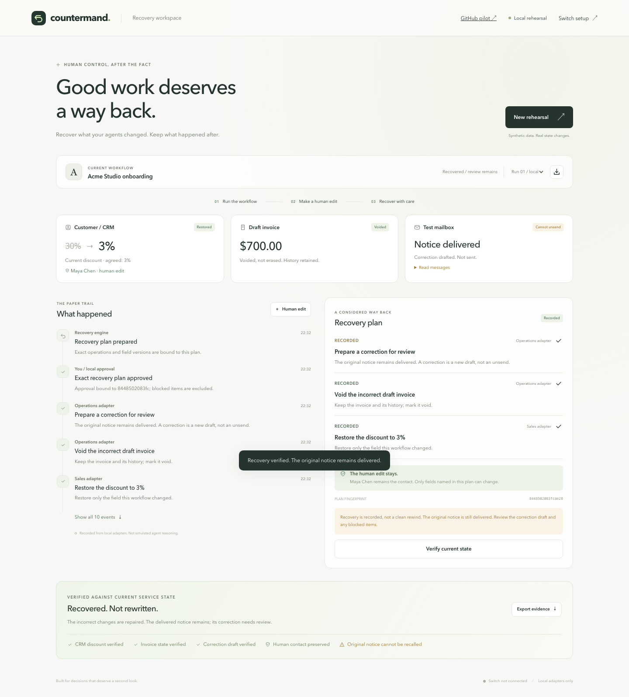

# Countermand

**Recover what your agents changed. Keep what happened after.**

A minimal recovery workspace for a completed workflow that turns out to be wrong.
It records exact changes, previews bounded compensations, binds approval to a plan,
and checks current field versions before any recovery writes.

Built for the **Flip the Switch hackathon**.

## The Problem

Your agents apply a discount, create an invoice, and deliver a notice. Then you
discover the instruction was wrong. Meanwhile, a teammate has updated the customer.

A blind rollback destroys newer work. A successful tool response does not prove
the consequences were repaired. And a delivered message cannot become unread.

Countermand makes the distinction explicit: **restore what is safe, compensate
what needs a different action, preserve newer work, and expose what remains.**



*Screenshot of the working synthetic rehearsal, not evidence of a live Switch run.*

## Current Status

| Component | Status |
| --- | --- |
| Recovery engine, SQLite journal, minimal responsive UI, JSON export | Implemented and tested |
| Synthetic CRM, draft invoice, local mailbox | Working deterministic adapters |
| Exact-plan approval, stale-plan refusal, field conflicts, scoped writes | Covered by automated tests |
| Sales and Operations stdio MCP clients | Implemented; provider wiring must be verified |
| Windows Switch Console, Cursor provider, Slack room with two agents | Configured by the operator; agents joined the room |
| Complete Switch-to-Countermand tool execution and recovery | Integration verification in progress |
| Authenticated Switch-human approval bridge | Not implemented; approval is local |
| Optional real GitHub Issues pilot | Implemented; tested with a fake provider, not live-verified |

**55 automated tests pass.** Browser checks pass on desktop and at 390px/360px
mobile widths. These checks were run on macOS; Windows execution needs its own check.

The UI and health endpoint still report `switch_connected: false`. This is a
fixed disclosure, not a live connection probe. A room existing or a run being
marked `switch` must not be presented as proof of completed integration.

## Run

Python 3.11+ is the only application prerequisite. No pip or npm install is needed.

### Windows

```powershell
git clone https://github.com/Tusharkshahi/countermand.git
cd countermand
.\start-windows.cmd
```

### macOS / Linux

```sh
git clone https://github.com/Tusharkshahi/countermand.git
cd countermand
python3 -m countermand.server
```

Open **http://127.0.0.1:8787**.

Run this from the repository root. The server binds only to loopback and stores
state and generated credentials in the ignored `.countermand/` directory.

If a local browser-preview proxy changes the browser's origin, explicitly allow
that exact loopback origin rather than disabling origin checks:

```sh
python3 -m countermand.server --browser-origin http://127.0.0.1:60571
```

Use your preview's actual port; the example is not a permanent requirement.

Windows scripts and the optional GitHub configuration are documented in
[WINDOWS.md](WINDOWS.md). Keep the server terminal running while using the UI or tools.

## Try The Story

**A two-minute local demonstration, without an agent account:**

1. Click **Run rehearsal**. A deliberately incorrect 30% discount is recorded,
   a $700 draft invoice is created, and a notice is delivered to a local mailbox.
   The customer's original agreed discount was 3%, on a $1,000 base.
2. Click **Human edit**. Save Maya's newer contact name.
3. Click **Preview recovery**. Inspect the exact operations and plan fingerprint.
4. Click **Approve & recover**. The owning adapters perform only their repairs.
5. Inspect the result: discount restored, draft invoice voided, contact preserved,
   and a correction drafted. The original notice remains delivered.
6. Export evidence to inspect receipts, field versions, approval, and verification.

For a conflict, start a **New rehearsal** and enable **Also change the discount
to 12%** in the human-edit dialog. Recovery preserves that newer discount and leaves
the decision unresolved; other approved repairs can proceed.

To test stale approval through the UI, preview a plan, then add a human edit to
the discount before approving. Approval is refused until a fresh plan is reviewed.
New rehearsals create isolated records; they never delete previous runs.

### What Makes The Demo Different

| Consequence | Recovery behavior |
| --- | --- |
| Incorrect 30% discount | Restore the recorded original 3%, if the targeted field is unchanged |
| Incorrect $700 draft invoice | Mark void; preserve its history |
| Maya's newer contact edit | Preserve; recovery never writes that field |
| Human changes the discount to 12% | Refuse to overwrite it; flag a human decision |
| Delivered local notice | Leave delivered; prepare a separate correction draft |
| State changes after preview | Refuse stale approval/execution; require a fresh plan |
| Recovery is retried | Do not repeat completed compensations |

The correction is not sent, and a replacement invoice is not automatically issued.
Those are new decisions, not hidden parts of an "undo everything" button.

## Where Switch Fits

Switch is the collaboration surface for the live-agent workflow: the human's
request, scoped agent handoff, recovery discussion, and verification report.
Countermand is the deterministic tool and evidence layer, not a second chatbot.

```text
Human + agents in a Switch room (Slack / Mattermost)
       |
       +-- Executor / Sales MCP ------ CRM discount operations
       |
       +-- Reviewer / Operations MCP - invoice, mailbox, verification
                         |
                  Countermand local API
                         |
              SQLite receipts + recovery engine
                         |
                Web UI / exact-plan review
```

The two adapters have different write scopes. The Operations agent both owns
its service repairs and verifies the overall result; this is not an isolated
third-party verifier or an OS-level security boundary.

### Live-Agent Setup

1. Start Countermand, then configure a supported provider in Switch. The current
   operator setup uses **Cursor Agent CLI on Windows**; the editor alone is insufficient.
2. Register an executor and reviewer with separate working directories and MCP
   configurations. Allow addressed handoffs between your own agents.
3. Launch each MCP using the commands below. Supply only its role credential
   privately, never the human approval credential.
4. A local human creates a run with `mode: "switch"` through the authenticated API.
   This disables browser impersonation of the owning adapters.
5. Have Sales apply the discount and hand the run ID to Operations for the invoice
   and notice. Add a human edit, then ask for a recovery proposal.
6. The human approves the stored plan and digest locally. Each owning agent
   executes its portion; verification reads the actual local adapter state.

```sh
python3 -m countermand.mcp --role sales
python3 -m countermand.mcp --role operations
```

Each process reads `COUNTERMAND_ADAPTER_TOKEN`. Alternatively, use
`--credential-file` with a private JSON file containing only that role's key.
On Windows use `py -3`; `py -3 -m countermand.doctor` prints absolute-path
process descriptions without revealing credential values.

There is deliberately **no agent-facing approval tool**. In external mode the
browser's combined **Approve & recover** rehearsal convenience is not the
execution path: human approval uses the local authenticated API, then agents
execute. A Slack "approved" message does not grant backend approval.

See [Switch handoff](switch/README.md), [agent briefs](switch/), and
[Switch's quickstart](https://docs.switchagents.ai/switch-rooms/getting-started).

## Safety Model

The language model is not responsible for enforcing these invariants:

- Mutations use registered operations, not generated SQL or arbitrary shell.
- Sales credentials cannot perform Operations mutations or approve a plan.
- Approval names a stored plan and its SHA-256 digest.
- Each targeted field is checked by value **and version**, including ABA changes.
- Check-and-write happens in a local SQLite transaction.
- Recovery receipts make retries idempotent.
- Changes to unrelated fields do not invalidate safe recovery or get overwritten.
- A delivered notice is never marked unsent. A correction remains a new draft.

The browser is a local human demo identity, not an authenticated production user.
The service credentials grant write scopes; the synthetic evidence ledger is shared.
Do not expose this server to a network or use production data.

## What This Does Not Prove

- The adapters share one local SQLite database. This is **not** a proof of
  cross-service atomicity, distributed rollback, or separate-machine isolation.
- The CRM/billing/mailbox story makes no real payments, production invoices, or
  external email deliveries. Agent chat in Switch is separate from the test mailbox.
- The action journal is persistent, not independently witnessed or tamper-proof.
- Recovery covers instrumented demo operations only.
- Recovery recipes are fixed and deterministic, not generated by a language model.
- The app does not authenticate a human's Switch identity or ingest approval from chat.
- Production execution needs per-service conditional writes, durable coordination,
  transport identity, stronger authorization, and service-specific compensation rules.
- A fully recovered local plan can still have irreversible or outstanding consequences.

## Optional GitHub Pilot

The `/github` workspace can create up to three marked issues in a human-authorized
repository run. It proposes closing untouched tracked issues and preserving changed
ones. It does not edit code, delete issues, or recover untracked existing issues.

**Writes are disabled by default.** Configuration requires a repository-scoped
Issues token, `--github-writes`, and explicit run authorization. See
[Windows/GitHub setup](WINDOWS.md).

This pilot rechecks state before closing and verifies afterward, but has **no
verified atomic compare-and-close guarantee**. Uncertain writes stop automatic
retries. Its tests use a fake GitHub provider; do not describe those as live API tests.

## Tests

```powershell
.\check-windows.cmd
```

Or run directly:

```sh
python3 -m unittest discover -s tests -v
node --check web/app.js
node --check web/view.js
node --check web/github.js
```

The optional browser test uses Node 22+ and an existing Chrome installation. It
uses Chrome's DevTools protocol directly; no browser package is downloaded.

```sh
node tests/browser.mjs
```

On platforms other than macOS, set `CHROME_PATH` to the Chrome executable. The test
starts an isolated server on port 8788, uses a fresh browser profile, and saves
screenshots under `.countermand/browser-tests/`. It does not touch your normal
browser profile or the main demo's database.

The browser harness defaults to `python3`; set `PYTHON` to your Python executable
when that name is unavailable on Windows. Node and Chrome are test-only dependencies.

## Layout

- `countermand/store.py`: persistent resources, field versions, and audit records.
- `countermand/workflow.py`: bounded forward operations and human-edit receipts.
- `countermand/recovery.py`: plan, approval, execution, and current-state verification.
- `countermand/server.py`: loopback web server and authenticated local API.
- `countermand/mcp.py`: role-scoped stdio tools; no human-approval tool.
- `countermand/github_*.py`: opt-in GitHub transport, receipts, recovery, and API routes.
- `web/`: dependency-free responsive interface.
- `tests/`: engine, authorization, transport, and browser checks.
- `switch/`: agent briefs and the remaining live-integration work.

## Next Steps Beyond The Hackathon

- Verify the complete real-room workflow and publish its receipts alongside a recording.
- Bind an authenticated Switch human decision to the exact backend plan and digest.
- Validate real provider conditional-write semantics and durable partial-failure recovery.
- Add supported workflows through explicit recovery contracts, not arbitrary reversal commands.
